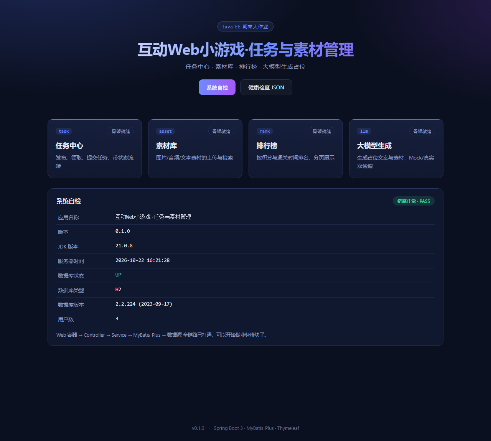

# 魔识 · 互动答题与素材管理

> Java EE 期末大作业 —— 「魔识」：知识闯关 / 任务中心 / 素材库 / 排行榜 / 大模型生成占位

「魔识」是一个基于 **Spring Boot 3 + MyBatis-Plus + Thymeleaf** 的互动答题平台，主玩法是五分区「知识闯关」，
配套任务中心、素材库、排行榜、大模型出题（Mock 通道）与只读管理后台。

Web 容器 → Controller → Service → MyBatis-Plus → 数据源整条链路已打通，登录鉴权、
服务端判分、成绩入库、任务发奖都已跑通；新增业务模块按
`module/<模块名>/{entity,mapper,service,controller,vo}` 分层往里填即可。




---

## 一分钟跑起来

### 方式一：H2 内存库（零配置，最推荐先试这个）

```bash
# Windows
mvnw.cmd spring-boot:run -Dspring-boot.run.profiles=h2

# macOS / Linux
./mvnw spring-boot:run -Dspring-boot.run.profiles=h2
```

打开 <http://localhost:8080>，点页面上的 **系统自检**，看到 `数据库状态 = UP` 即成功。
数据全在内存里，重启即清空，不影响本机 MySQL。

### 方式二：MySQL（正式档 / 答辩用）

```bash
# 1) 建库（只需一次）
mysql -u root -p < src/main/resources/db/init-mysql.sql

# 2) 告诉应用密码（不要写进代码/仓库）
set DB_PASSWORD=你的MySQL密码          # Windows CMD
$env:DB_PASSWORD="你的MySQL密码"       # PowerShell

# 3) 启动（默认就是 mysql 档）
mvnw.cmd spring-boot:run
```

建表由 `spring.sql.init` 自动执行 `db/schema-mysql.sql`，脚本全部是
`CREATE TABLE IF NOT EXISTS`，重复启动不会清数据。

---

## 技术栈

| 层次 | 选型 | 说明 |
| --- | --- | --- |
| 运行环境 | JDK 25 LTS | Spring Boot 3.5.16，与 Java 25 兼容 |
| 框架 | Spring Boot 3.5.16 | 内嵌 Tomcat，打包成 jar 直接 `java -jar` |
| 持久层 | MyBatis-Plus 3.5.9 | `BaseMapper` / `IService` 免写单表 SQL，分页插件已配 |
| 数据库 | MySQL 9.x（主）/ H2（演示档） | MySQL 驱动用 9.1.0，兼容 8.x 与 9.x 服务端 |
| 视图 | Thymeleaf | 服务端渲染，页面不依赖 CDN，断网也能演示 |
| 其他 | Lombok / Validation / Actuator | 简化样板代码、参数校验、健康检查 |

> 没用 JSP + 外置 Tomcat 的原因：Spring Boot 内嵌容器打包即跑，
> 答辩现场不用现场配置 Tomcat；本机 `D:\java\Tomcat` 仍保留，需要时可切回 WAR 方案。

---

## 在 VS Code 中开发

本机编辑器是 **VS Code**（`E:\Microsoft VS Code`），不是 Visual Studio IDE。
`.vscode/` 已配好并随仓库提交，clone 下来就有同样的入口：

| 文件 | 作用 |
| --- | --- |
| `settings.json` | Java 工具链指向 JDK 25，构建统一走 Maven Wrapper |
| `launch.json` | 按 `F5` 直接启动：`H2 演示档` / `MySQL 正式档` 两套，可打断点 |
| `tasks.json` | `Ctrl+Shift+B` 编译，另有跑测试、`spring-boot:run` 任务 |
| `extensions.json` | 打开项目时提示安装 Java / Spring Boot 扩展 |

首次打开按三步走：

1. 装扩展 —— 右下角弹窗点「安装」，或 `Extensions: Show Recommended Extensions`（需要 `Extension Pack for Java`）
2. 等语言服务器导入 Maven 项目，右下角 `Java: Importing…` 转圈，首次 1-3 分钟
3. 按 `F5` 选「启动 · H2 演示档」，浏览器打开 <http://localhost:8080>

注意两点：

- `settings.json` 里的 JDK 路径是本机绝对路径（`D:\java\JDK_25`），换电脑要改
- 只提交上面四个文件，其余 `.vscode/*`（如工作区缓存）已在 `.gitignore` 里排除

---

## 项目结构

```
.
├── pom.xml
├── mvnw / mvnw.cmd / .mvn/            # Maven Wrapper，没装 Maven 的机器也能构建
├── src/main/java/com/example/minigame/
│   ├── MinigameApplication.java       # 启动类，@MapperScan 在这里
│   ├── common/                        # ApiResult 统一响应、全局异常、AuthUtil 登录态常量
│   ├── config/                        # 分页插件、拦截器注册、/uploads 静态映射
│   └── module/                        # 按业务模块分包，一个模块一个文件夹
│       ├── user/     entity/mapper/service/controller        # 用户、登录注册（BCrypt）
│       ├── quiz/     entity/mapper/service/controller/dto/vo  # 题库、开局判分、成绩、分区常量
│       │             └── bootstrap/   # QuestionSeeder：题库 JSON 幂等灌库
│       ├── task/     entity/mapper/service/controller/vo      # 任务进度与领奖
│       │             └── bootstrap/   # TaskSeeder
│       ├── asset/    entity/mapper/service/controller         # 素材上传与浏览
│       ├── llm/      service/controller/vo                    # 大模型出题（Mock）
│       ├── game/     controller/vo                            # /games 入口 → /games/quiz
│       └── system/   controller/vo                            # 首页、排行榜、/api/ping 自检
├── src/main/resources/
│   ├── application.yml                # 公共配置 + 默认 profile（mysql）
│   ├── application-mysql.yml          # MySQL 档
│   ├── application-h2.yml             # H2 演示档
│   ├── db/                            # 建库建表脚本（mysql / h2 各一套）
│   ├── seed/questions.json            # 60 道题，MySQL/H2 共用一份
│   ├── templates/                     # Thymeleaf 页面 + fragments/nav.html 统一导航
│   └── static/                        # css / js / favicon.svg，全部本地，无 CDN 依赖
└── src/test/java/                     # @SpringBootTest + H2 档冒烟测试，CI 上不需要 MySQL
```

**约定**：新增业务模块时按 `module/<模块名>/{entity,mapper,service,controller,vo}` 建包，
不往 `common` 里塞业务代码。

---

## 接口约定

统一响应体（`common/ApiResult`）：

```json
{ "code": 0, "message": "ok", "data": { } }
```

`code = 0` 成功，`400` 参数问题，`500` 服务端异常。前端 `static/js/app.js` 按此结构解析。

**答题与判分流程（防作弊）**

```
GET  /api/quiz/modes   → 难度档（简单/普通/困难：题数、限时、抽题难度）
POST /api/quiz/start?category=xxx&mode=yyy → 按难度抽题，答案留在 Session，只下发题干+选项
     ↓ 逐题作答 POST /api/quiz/answer {roundId, index, answer} → 即时返回对错/连击/本题得分
POST /api/quiz/submit → 服务端结算、写 t_score，返回逐题解析
```

答案从不下发到浏览器，`F12` 看不到；耗时也由服务端从开局计时，不采信前端上报。

计分规则（三档难度、四大机制）：
- 基础分按难度分档：简单 10 / 中等 20 / 困难 30；
- 连击加成：连续答对第 n 题额外 +(n-1)×2，答错清零；
- 失误惩罚：答错或超时每题 -5；
- 速度加成：提前完成每秒 +2、最多 +50。

一局总分 = max(0, 基础分 + 连击加成 − 失误扣分) + 速度加成。未登录可以玩，但成绩不入库。

| 方法 | 路径 | 说明 |
| --- | --- | --- |
| GET | `/` | 首页（统一导航栏 + 模块一览 + 自检） |
| GET | `/login` | 登录页（演示账号 `player01` / `admin`，密码 `password`） |
| GET | `/register` | 注册页，BCrypt 加盐存储 |
| POST | `/login`、`/register`、`/logout` | 登录 / 注册 / 退出（表单提交） |
| GET | `/profile` | 个人中心，**需登录** |
| GET | `/admin` | 管理后台，**仅 ADMIN**（题库与用户只读概览） |
| GET | `/rank` | 排行榜：总榜 + 分区榜，分数降序、同分按用时升序取 Top 10 |
| GET | `/tasks` | 任务中心：任务进度按成绩实时计算，完成可领奖励 |
| POST | `/tasks/{id}/claim` | 领取任务奖励（需登录、已完成、未领过） |
| GET | `/assets` | 素材库：按分区浏览 + 上传表单 |
| POST | `/assets/upload` | 上传图片（需登录，仅 png/jpg/jpeg/gif/webp，≤10MB） |
| GET | `/uploads/**` | 素材文件静态访问（映射到磁盘 `uploads/`） |
| GET | `/llm` | 大模型生成：分区+主题出题（Mock 通道） |
| POST | `/llm/generate` | 触发一次生成 |
| GET | `/games` | 入口，302 跳转到 `/games/quiz` |
| GET | `/games/quiz` | 知识闯关：分区选择 → 答题 → 服务端判分结算 |
| GET | `/api/quiz/modes` | 难度档列表：简单/普通/困难（题数、限时、抽题难度） |
| GET | `/api/quiz/categories` | 题库五个分区 + 各分区题量 |
| POST | `/api/quiz/start` | 开局：按难度抽题下发，**不含答案**，返回 `roundId` |
| POST | `/api/quiz/answer` | 逐题作答：返回对错/连击/本题得分（即时反馈） |
| POST | `/api/quiz/submit` | 交卷：服务端结算 + 入库，返回逐题解析 |
| GET | `/api/ping` | 系统自检：JDK、数据库类型/版本、用户数 |
| GET | `/actuator/health` | 标准健康检查 JSON |
| GET | `/h2-console` | 仅 H2 档可用，浏览器直接看表 |

---

## 配置项

| 配置 | 环境变量 | 默认值 | 说明 |
| --- | --- | --- | --- |
| 数据源用户名 | `DB_USER` | `root` | |
| 数据源密码 | `DB_PASSWORD` | 空 | **只从环境变量读，禁止硬编码** |
| 库名 | `DB_NAME` | `minigame` | |
| 端口 | — | `8080` | 改了记得同步 README |
| 大模型模式 | — | `mock` | `mock` 用本地假数据，`real` 走真实接口 |
| 大模型 Key | `LLM_API_KEY` | 空 | 未配置时自动停留在 mock 通道 |

真实 Key、真实密码放进 `application-local.yml`（已在 `.gitignore` 里），
或直接用环境变量，**两者都不要提交到 GitHub**。

---

## 进度

- [x] 工程骨架、依赖、双数据库档、统一响应、全局异常
- [x] 用户表 + MyBatis-Plus 链路打通
- [x] 首页与系统自检（`/api/ping`、`/actuator/health`）
- [x] 知识闯关：五分区 60 题入库、开局抽题、**服务端判分**、成绩写 `t_score`
- [x] 登录注册（BCrypt + Session + 拦截器，`/profile` 需登录、`/admin` 需 ADMIN）
- [x] 排行榜：总榜 + 分区榜，分数降序、同分按用时升序取 Top 10
- [x] 个人中心：真实战绩、最好成绩、分区统计
- [x] 任务中心：进度按成绩实时计算 + 领取奖励（`t_task` / `t_user_task`，唯一键防重复领）
- [x] 素材库：图片上传（后缀白名单 + UUID 落盘）、按分区浏览
- [x] 大模型出题：Mock 通道可用，接口形状与真实模型一致
- [ ] 大模型真实通道：`app.llm.mode=real` + `LLM_API_KEY` 还没接（当前恒为 Mock）
- [ ] 管理后台写操作：题目/任务增删改、上下架、用户禁用
- [ ] 接口文档（springdoc-openapi）

---

## 常见问题

**`UnsupportedClassVersionError` / 编译报 61 版本**
PATH 里 `java` 可能指向了老的 JRE 1.8。构建交给 Maven 用 `JAVA_HOME` 就行；
若 `java -jar` 报错，先把 `JAVA_HOME` 指向 JDK 25 并把 `%JAVA_HOME%\bin` 放到 PATH 最前。

**连不上 MySQL：`Access denied`**
密码没通过环境变量传进去，或 `DB_USER` 不是 root。先确认
`mysql -u root -p -e "select 1"` 在命令行能连。

**MySQL 9 驱动报错**
本项目 `pom.xml` 已把 `mysql-connector-j` 显式定到 9.1.0，
Spring Boot 默认管理的 8.3.0 在 9.x 服务端上可能握手失败。

**端口 8080 被占**
`mvnw.cmd spring-boot:run -Dspring-boot.run.arguments=--server.port=8081`

---

## 上传到 GitHub

```bash
git init
git add .
git commit -m "chore: 初始化工程骨架"
git remote add origin https://github.com/yelin-05/interactive_game.git
git push -u origin master        # 本仓库主分支是 master
```

> 用 **GitHub Desktop** 更省事：`Add local repository` 加进本地目录 →
> `Publish repository`，它会在 GitHub 上自动建空仓库再推，不用操心远端初始提交冲突。
> 推之前记得把 `Settings → Emails` 里的 noreply 邮箱配成 `git config user.email`，
> 否则提交记录不会算到你账号名下（仓库页 Contributors 会显示 No contributors）。

推之前自查一遍：

```bash
git status                        # 不该出现 target/、.idea/
git grep -n -i "password\|api-key" -- ':!*.md'   # 不该出现真实密码/Key
```

仓库 `.gitignore` 已排除 `target/`、`.idea/`、`application-local.yml`、
`.env`、`*.log` 与上传目录。CI 见 `.github/workflows/ci.yml`。

---

## License

MIT
