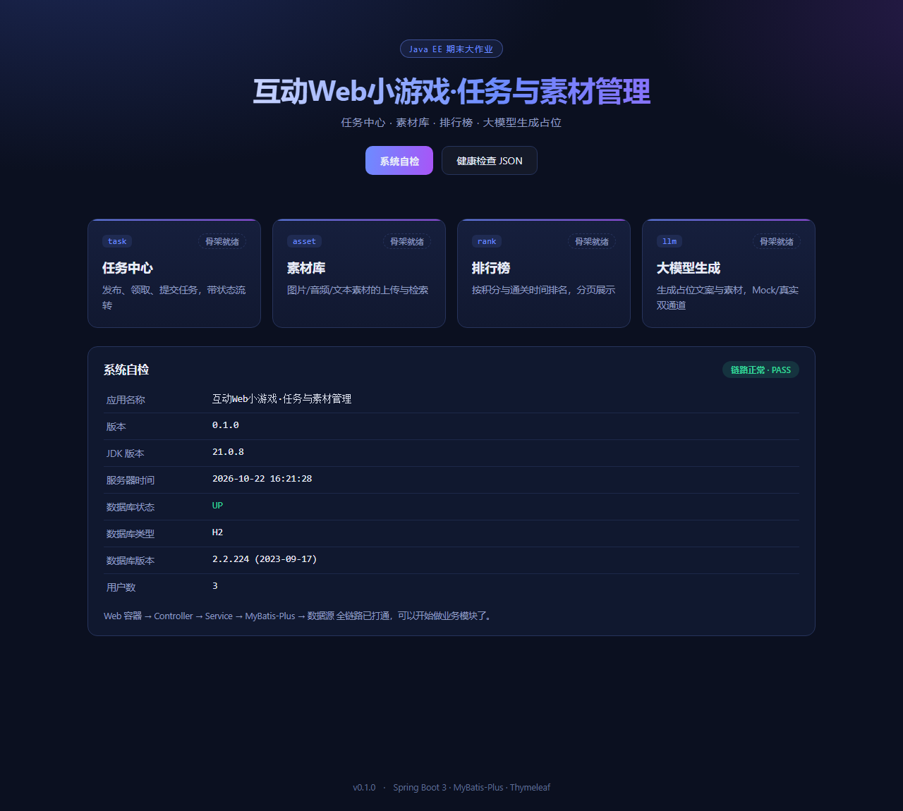

# 互动 Web 小游戏 · 任务与素材管理

> Java EE 期末大作业 —— 任务中心 / 素材库 / 排行榜 / 大模型生成占位

一个基于 **Spring Boot 3 + MyBatis-Plus + Thymeleaf** 的互动小游戏后台与展示平台。
当前处于「骨架 + 最小纵向切片」阶段：Web 容器 → Controller → Service → MyBatis-Plus → 数据源
整条链路已打通，业务模块按同一分层往里填即可。




---

## 一分钟跑起来

### 方式一：H2 内存库（零配置，最推荐先试这个）

```bash
# Windows
mvnw.cmd spring-boot:run -Dspring-boot.run.profiles=h2

# macOS / Linux
./mvnw spring-boot:run -Dspring-boot.run.profiles=h2
```

打开 <http://localhost:8080>，点页面上的 **系统自检**，看到 `数据库状态 = UP` 即成功。
数据全在内存里，重启即清空，不影响本机 MySQL。

### 方式二：MySQL（正式档 / 答辩用）

```bash
# 1) 建库（只需一次）
mysql -u root -p < src/main/resources/db/init-mysql.sql

# 2) 告诉应用密码（不要写进代码/仓库）
set DB_PASSWORD=你的MySQL密码          # Windows CMD
$env:DB_PASSWORD="你的MySQL密码"       # PowerShell

# 3) 启动（默认就是 mysql 档）
mvnw.cmd spring-boot:run
```

建表由 `spring.sql.init` 自动执行 `db/schema-mysql.sql`，脚本全部是
`CREATE TABLE IF NOT EXISTS`，重复启动不会清数据。

---

## 技术栈

| 层次 | 选型 | 说明 |
| --- | --- | --- |
| 运行环境 | JDK 21 | Spring Boot 3 要求 17+；本机 `JAVA_HOME=D:\java\JDK_21` |
| 框架 | Spring Boot 3.3.5 | 内嵌 Tomcat，打包成 jar 直接 `java -jar` |
| 持久层 | MyBatis-Plus 3.5.9 | `BaseMapper` / `IService` 免写单表 SQL，分页插件已配 |
| 数据库 | MySQL 9.x（主）/ H2（演示档） | MySQL 驱动用 9.1.0，兼容 8.x 与 9.x 服务端 |
| 视图 | Thymeleaf | 服务端渲染，页面不依赖 CDN，断网也能演示 |
| 其他 | Lombok / Validation / Actuator | 简化样板代码、参数校验、健康检查 |

> 没用 JSP + 外置 Tomcat 的原因：Spring Boot 内嵌容器打包即跑，
> 答辩现场不用现场配置 Tomcat；本机 `D:\java\Tomcat` 仍保留，需要时可切回 WAR 方案。

---

## 在 VS Code 中开发

本机编辑器是 **VS Code**（`E:\Microsoft VS Code`），不是 Visual Studio IDE。
`.vscode/` 已配好并随仓库提交，clone 下来就有同样的入口：

| 文件 | 作用 |
| --- | --- |
| `settings.json` | Java 工具链指向 JDK 21，构建统一走 Maven Wrapper |
| `launch.json` | 按 `F5` 直接启动：`H2 演示档` / `MySQL 正式档` 两套，可打断点 |
| `tasks.json` | `Ctrl+Shift+B` 编译，另有跑测试、`spring-boot:run` 任务 |
| `extensions.json` | 打开项目时提示安装 Java / Spring Boot 扩展 |

首次打开按三步走：

1. 装扩展 —— 右下角弹窗点「安装」，或 `Extensions: Show Recommended Extensions`（需要 `Extension Pack for Java`）
2. 等语言服务器导入 Maven 项目，右下角 `Java: Importing…` 转圈，首次 1-3 分钟
3. 按 `F5` 选「启动 · H2 演示档」，浏览器打开 <http://localhost:8080>

注意两点：

- `settings.json` 里的 JDK 路径是本机绝对路径（`D:\java\JDK_21`），换电脑要改
- 只提交上面四个文件，其余 `.vscode/*`（如工作区缓存）已在 `.gitignore` 里排除

---

## 项目结构

```
.
├── pom.xml
├── mvnw / mvnw.cmd / .mvn/            # Maven Wrapper，没装 Maven 的机器也能构建
├── src/main/java/com/example/minigame/
│   ├── MinigameApplication.java       # 启动类，@MapperScan 在这里
│   ├── common/                        # ApiResult 统一响应、全局异常处理
│   ├── config/                        # MyBatis-Plus 分页等配置
│   └── module/                        # 按业务模块分包，一个模块一个文件夹
│       ├── user/                      # entity / mapper / service
│       └── system/                    # 首页、自检接口
├── src/main/resources/
│   ├── application.yml                # 公共配置 + 默认 profile
│   ├── application-mysql.yml          # MySQL 档
│   ├── application-h2.yml             # H2 演示档
│   ├── db/                            # 建库建表脚本（mysql / h2 各一套）
│   ├── templates/index.html           # 首页
│   └── static/css|js                  # 本地静态资源，无 CDN 依赖
└── src/test/java/                     # 冒烟测试，CI 上不需要 MySQL
```

**约定**：新增业务模块时按 `module/<模块名>/{entity,mapper,service,controller,vo}` 建包，
不往 `common` 里塞业务代码。

---

## 接口约定

统一响应体（`common/ApiResult`）：

```json
{ "code": 0, "message": "ok", "data": { } }
```

`code = 0` 成功，`400` 参数问题，`500` 服务端异常。前端 `static/js/app.js` 按此结构解析。

| 方法 | 路径 | 说明 |
| --- | --- | --- |
| GET | `/` | 首页，四个模块卡片 + 自检面板 |
| GET | `/games` | 小游戏模板选型（C 知识闯关已选定） |
| GET | `/games/quiz` | 知识闯关：分区选择 → 答题 → 结算 |
| GET | `/api/quiz/categories` | 题库五个分区 + 各分区题量 |
| GET | `/api/quiz/questions` | 按分区随机抽题，参数 `category`、`limit` |
| GET | `/api/ping` | 系统自检：JDK、数据库类型/版本、用户数 |
| GET | `/actuator/health` | 标准健康检查 JSON |
| GET | `/h2-console` | 仅 H2 档可用，浏览器直接看表 |

---

## 配置项

| 配置 | 环境变量 | 默认值 | 说明 |
| --- | --- | --- | --- |
| 数据源用户名 | `DB_USER` | `root` | |
| 数据源密码 | `DB_PASSWORD` | 空 | **只从环境变量读，禁止硬编码** |
| 库名 | `DB_NAME` | `minigame` | |
| 端口 | — | `8080` | 改了记得同步 README |
| 大模型模式 | — | `mock` | `mock` 用本地假数据，`real` 走真实接口 |
| 大模型 Key | `LLM_API_KEY` | 空 | 未配置时自动停留在 mock 通道 |

真实 Key、真实密码放进 `application-local.yml`（已在 `.gitignore` 里），
或直接用环境变量，**两者都不要提交到 GitHub**。

---

## 进度

- [x] 工程骨架、依赖、双数据库档、统一响应、全局异常
- [x] 用户表 + MyBatis-Plus 链路打通
- [x] 首页与系统自检
- [ ] 任务中心：发布 / 领取 / 提交 / 状态流转
- [ ] 素材库：上传、分类、检索、缩略图
- [ ] 排行榜：积分与通关时间排序、分页
- [ ] 大模型生成占位：Mock / 真实双通道切换
- [ ] 登录鉴权（BCrypt + 拦截器或 Spring Security）
- [ ] 接口文档（springdoc-openapi）

---

## 常见问题

**`UnsupportedClassVersionError` / 编译报 61 版本**
PATH 里 `java` 可能指向了老的 JRE 1.8。构建交给 Maven 用 `JAVA_HOME` 就行；
若 `java -jar` 报错，先把 `JAVA_HOME` 指向 JDK 21 并把 `%JAVA_HOME%\bin` 放到 PATH 最前。

**连不上 MySQL：`Access denied`**
密码没通过环境变量传进去，或 `DB_USER` 不是 root。先确认
`mysql -u root -p -e "select 1"` 在命令行能连。

**MySQL 9 驱动报错**
本项目 `pom.xml` 已把 `mysql-connector-j` 显式定到 9.1.0，
Spring Boot 默认管理的 8.3.0 在 9.x 服务端上可能握手失败。

**端口 8080 被占**
`mvnw.cmd spring-boot:run -Dspring-boot.run.arguments=--server.port=8081`

---

## 上传到 GitHub

```bash
git init
git add .
git commit -m "chore: 初始化工程骨架"
git remote add origin https://github.com/yelin-05/interactive_game.git
git push -u origin master        # 本仓库主分支是 master
```

> 用 **GitHub Desktop** 更省事：`Add local repository` 加进本地目录 →
> `Publish repository`，它会在 GitHub 上自动建空仓库再推，不用操心远端初始提交冲突。
> 推之前记得把 `Settings → Emails` 里的 noreply 邮箱配成 `git config user.email`，
> 否则提交记录不会算到你账号名下（仓库页 Contributors 会显示 No contributors）。

推之前自查一遍：

```bash
git status                        # 不该出现 target/、.idea/
git grep -n -i "password\|api-key" -- ':!*.md'   # 不该出现真实密码/Key
```

仓库 `.gitignore` 已排除 `target/`、`.idea/`、`application-local.yml`、
`.env`、`*.log` 与上传目录。CI 见 `.github/workflows/ci.yml`。

---

## License

MIT
